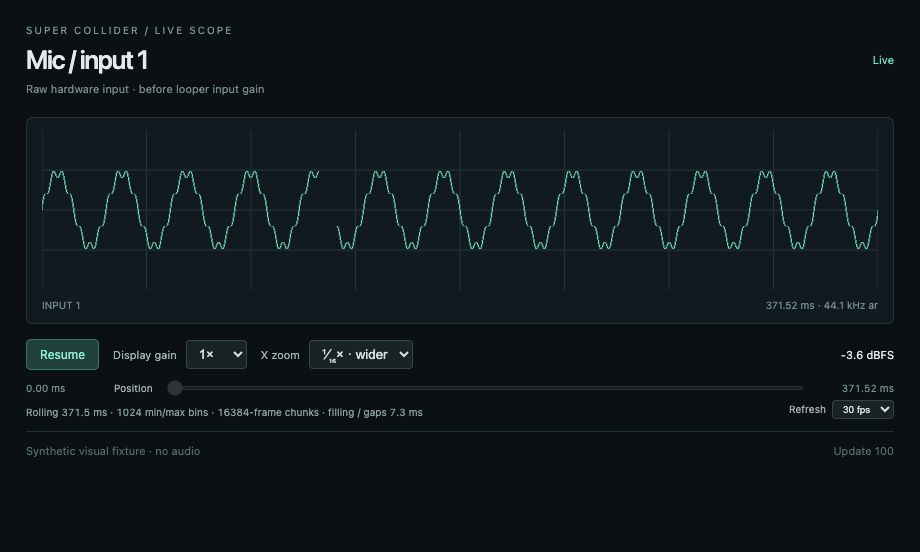
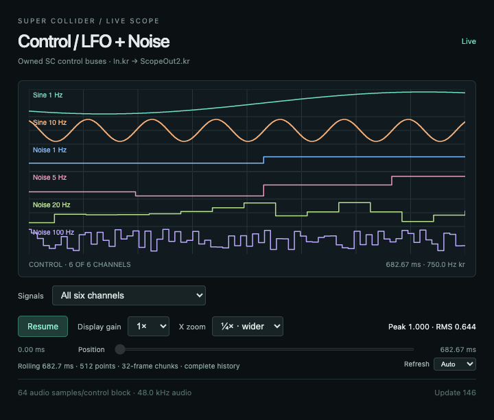
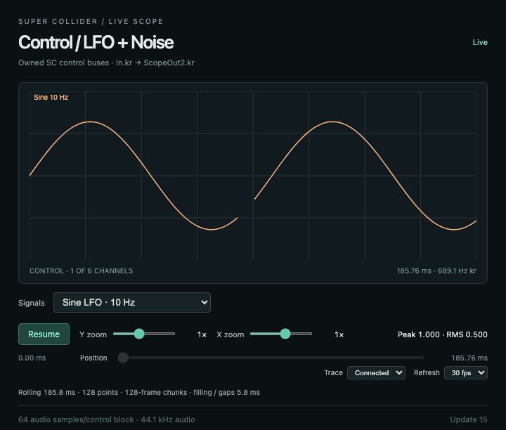
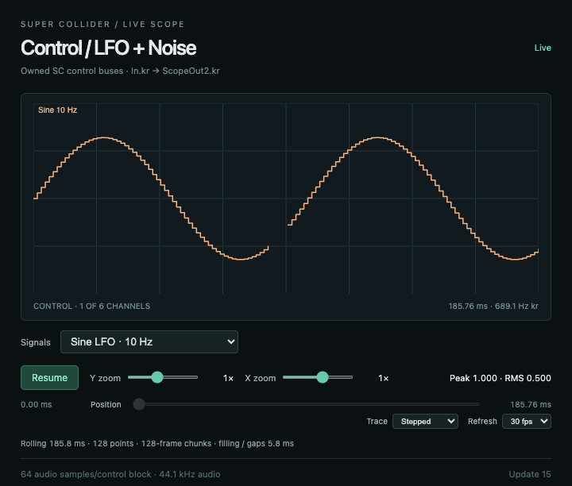

# Scope metadata and trace polish — 2026-10-03

Meters and rolling text now update at **8 Hz**, independently of waveform painting. Auto/30/15 fps still controls only painting; source capture, binary delivery, ACKs and history append are unchanged. Connection transitions and user zoom/pan/selection/freeze actions update their relevant labels immediately. Unchanged text/attributes are not rewritten. Rendered sequence/source-clock/paint counters remain attached to each actual paint for diagnostics.

Raw audio traces use rounded joins/caps. Zoomed-out min/max bins form a connected, lightly filled envelope instead of isolated vertical sticks. Every measured lower/upper bound remains in the path; NaNs split it into separate runs so missing audio is not drawn across. Control-rate signals now retain their ordered raw samples throughout the widened view and draw one sample-and-hold trace per channel, including noise jumps. The first version incorrectly outlined control min/max bounds as two traces; the correction below replaces that geometry. No audio samples are filtered or changed. This improves trace presentation; it does not repair missing capture data or add oscilloscope triggering.

## Verification

- **36 scope unit tests pass**, including three metadata scheduler tests and four trace fidelity tests. They verify independent cadence, freeze/control flushing, timer cancellation, extrema, planar channel selection, gaps and control steps.
- **The actual-shell shared-loop Electron gate passes**: live mic/output/control sources, binary-v5, zoom/pan/reset, widened history, freeze, 30/15 fps painting, selectors, raw SC Bus peer isolation, host survival and final-release cleanup. Field and Studio tool views are not opened.
- A retained **synthetic Electron fixture** compares identical samples before/after: metadata changes fell from **29.9/s to 8.0/s**, while wave painting stayed at **29.9/s**. It retains an intentional 320-source-sample gap and verifies freeze. Samples intentionally repeat, so unchanged screenshots during the activity interval are expected. This fixture requests a simulated 44.1 kHz rate; it is not a live 44.1 kHz audio measurement.
- Visual inspection confirms a continuous envelope and an honest gap. All **142 other guarded originals** from the prior comparison match their hashes. The intended guarded modification is `scope.js`; `server.mjs` also gains only the two static JS asset routes, outside that guard inventory. Native/SC/broker/capture/transport/reduction/history and published Lissajous assets are unchanged.
- Initial live checks caught the first binary marker and frozen zoom diagnostics waiting for a metadata timer. Those state/control updates are now immediate and the final gate passes. At that initial validation, CPU had not yet been remeasured. The subsequent [36-phase CPU comparison](scope-ui-costs.md) measures both the audio improvements and widest-control cost increase. Earlier CPU reports remain historical evidence.

## Before and after

Both pictures use the same synthetic samples, plot dimensions, gain and deliberate gap.

Before:



After:


## Files and reproduction

- `tool-artifacts/shared-loop/0.1.0/public/scope.js`: separates snapshots, text and painting.
- `public/scope-metadata.js`: coalesces text updates, no recurring idle timer.
- `public/scope-trace.js`: shared raw/envelope/control drawing.
- `server.mjs`: serves the new assets. Existing benchmark adapters also serve them.
- [Synthetic fixture](../test/scope-ui/visual.mjs), [cadence evidence](../test/scope-ui/results/2026-10-03/activity.json), [unit log](../test/scope-ui/results/2026-10-03/awb-scope-polish-units.log), [live log](../test/scope-ui/results/2026-10-03/awb-scope-polish-live.log), [source guards](../test/scope-ui/results/2026-10-03/environment.json).

From AWB, with Node 22 first in PATH:

```sh
node --test tool-artifacts/shared-loop/0.1.0/tests/*.test.mjs
node --test apps/awb-shell/test/electron-shared-loop.test.mjs
env -u ELECTRON_RUN_AS_NODE ./node_modules/.bin/electron apps/awb-shell/test/scope-ui/visual.mjs
```

A running Shared Loop backend needs reopening to serve the two new modules; reopening just its scopes on an old backend is insufficient. Closing the demo releases its loop buffer, so do this between takes. No native rebuild, device/rate change or manual SC reboot is required. No live user instrument/host was restarted during verification.

Changes remain uncommitted on `design/score-studio-layout`. Vault and Telegram MCP tools are absent, so no direct vault-file substitute or external notification was used.

## Control single-line correction — 2026-10-03

The user screenshot revealed a regression missed by the first visual fixture: zoomed-out control lanes had upper/lower envelope outlines and rectangular steps. Raw control sample ordering is now retained in the display history at every zoom. Control views always request the existing step-1 capture profile; only the browser history span changes. The native tap/rate/channel allocation, broker, reduction implementation, audio-scope reduction and Lissajous route are unchanged. No midpoint or synthetic noise level is used to guess the signal from min/max pairs. The trace helper rejects min/max input for control drawing.

At ¼×, a control view now draws 512 raw points; at ¹⁄₁₆× it draws 2,048. The time span is unchanged. This trades the old reduced display traffic/vertex count for exact ordered transitions; the subsequent [CPU comparison](scope-ui-costs.md) measures a 47.7% paired total-cost increase for six lanes at ¹⁄₁₆×, mostly GPU-process CPU. The 8 Hz metadata scheduler is retained.

The 37 scope unit tests pass, including exact ordered 2,048-sample history and single open control-path checks. The live shell gate additionally verifies the screenshot's ¼× case with **six open paths and zero closed polygons**, plus ¹⁄₁₆× raw history, LFO timing, independent noise, selectors, freeze, source-peer isolation and cleanup. The live image was inspected:



[Live gate log](../test/scope-ui/results/2026-10-03/control-single-line/awb-control-line-live.log) · [Unit log](../test/scope-ui/results/2026-10-03/control-single-line/awb-control-line-units.log) · [Current source hashes](../test/scope-ui/results/2026-10-03/control-single-line/environment.json). Earlier screenshots and logs above describe the initial polish and remain historical evidence.

For this correction, close and reopen **only the control scope**. Its existing backend already serves these modules; the looper can keep running and its buffer need not be reset.


## Trace connection modes — 2026-10-03

**Connected is now the default for every individual-sample trace.** The Trace selector below
the plot offers Connected or Stepped, using exactly the same measured values. No source
classification is involved: sine, noise and unknown incoming signals follow the user's choice.
Connected draws straight segments between consecutive samples; Stepped holds each value
horizontally before moving to the next. This is visual interpolation only, with no filtering or
new sample generation. NaNs still break paths. Cropping, planar channel selection, amplitude
clipping and rounded joins remain intact. Reduced audio retains its existing min/max envelope;
the selector is disabled for that format and remembers its raw mode until samples return.

The selector redraws frozen data without resuming capture. It causes no capture requests.
The mode is cached outside the paint loop; selector state/title updates use the existing 8 Hz
metadata scheduler, with writes only when changed. Waveform paint caps are unchanged. The
control sliders are slightly narrower and bottom padding is reduced to keep stereo levels
and the new selector within the existing 720×520 audio / 720×640 control windows, without
scrollbars.

The two pictures below use the same synthetic 44.1 kHz / block-64 source, 128 control samples,
gain, dimensions and deliberately missing four samples. The gap is intentional test data.





Verification: **38 focused scope units pass**, including source-independent geometry, gaps,
cropping/channel selection, unchanged data and min/max bounds. The synthetic Electron fixture
passes with the actual HTTP-served scope assets and full stylesheet, checking mode pixel
changes, exact pixel restoration, unchanged frozen clocks/levels/gaps, frozen zoom/pan, no
capture requests, raw↔min/max selector state, default viewport fit and viewer cleanup. Its
screenshots were visually inspected. It simulates data and does not boot SC or use hardware.

The existing actual-shell Shared Loop gate also passes (1/1), including mic/output/control,
sliders, raw PCM peer isolation, demand/lifecycle, binary delivery, cadence and cleanup. It
uses detected device/server rates without overrides and opens no unrelated tool views. The
first run caught a stereo level row wrapping beyond the default viewport; narrower slider
columns correct it. An initial sandbox unit run could not bind local sockets; the authorized
rerun passes all 38. Neither failure remains outstanding.

Of 46 guarded original sources, only scope.html/css/js and scope-trace.js change. The native,
SC, broker, transport and shell main sources remain unchanged. The trace unit tests and a
[focused UI fixture](../test/scope-ui/trace-modes.mjs) are also updated/added. No new CPU
measurement or saving is claimed; previous performance reports remain historical.

[UI results](../test/scope-ui/results/2026-10-03/trace-modes/results.json) ·
[Unit log](../test/scope-ui/results/2026-10-03/trace-modes/units.log) ·
[Live shell log](../test/scope-ui/results/2026-10-03/trace-modes/live.log) ·
[Source guards](../test/scope-ui/results/2026-10-03/trace-modes/environment.json).

From AWB, with Node 22 first in PATH:

```sh
node --test tool-artifacts/shared-loop/0.1.0/tests/scope-*.test.mjs
env -u ELECTRON_RUN_AS_NODE ./node_modules/.bin/electron apps/awb-shell/test/scope-ui/trace-modes.mjs
node --test apps/awb-shell/test/electron-shared-loop.test.mjs
```

Close/reopen **only the scope windows** to load the change. No build, looper-buffer reset or
SC host restart is required. Changes remain uncommitted on design/score-studio-layout.
Vault and Telegram MCP tools are unavailable; no vault-file fallback or notification was sent.
