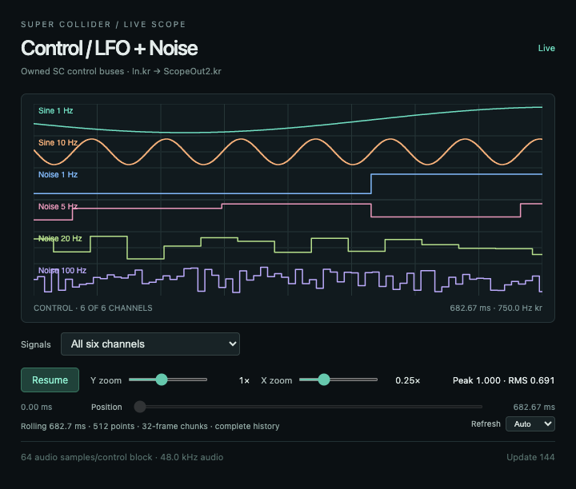

# Scope X/Y zoom sliders — 2026-10-03

The mic, output and control scopes replace the X zoom and display-gain menus with logarithmic range sliders. **X: ¹⁄₁₆×–8×. Y: ¹⁄₁₆×–64×.** Both start at 1×, show their current multiplier, support keyboard adjustment, and reset to 1× on double-click. Dragging updates the picture immediately without bypassing the waveform paint cap; release requests a prompt final redraw. Y changes visual amplitude only. Peaks/RMS still describe the unscaled source.

X display zoom supports fractional values. Audio still uses the supported step-1/4/16 reduction profiles; the backend receives only 1, ¼ or ¹⁄₁₆ capture settings. Control history remains ordered raw samples at every zoom. Fractional history spans round down to complete source bins, stay within the existing bounded ring, and use that actual span for the time ruler. The old fixed zoom positions retain their original duration/sample counts. Changes across a profile boundary may refill history, as before.

Capture requests are serialized and superseded/duplicate queued requests are skipped. In the live test, 24 rapid X input events alternating across a profile boundary produce just one capture request for audio, and none for control. Those display profile changes reuse the same physical SC capture. Native allocation, SC rate/device selection, raw peer PCM, transport protocol, history implementation and trace geometry are unchanged.

Zooming and panning within a frozen snapshot keeps its source clock fixed. Widening beyond the available frozen span resumes rolling history; changing an audio capture profile also resumes it. No sample interpolation or waveform smoothing was added here.

## Verification

- 37 existing scope units pass.
- Actual-shell shared-loop gate passes, with new slider checks for mic/output/control: fractional spans across both reduction bands, correctly scaled duration, request coalescing, independent Y pixel changes on a frozen trace, fractional frozen X/pan, double-click reset, and viewport fit.
- The three physical capture generations stay unchanged throughout those checks. The raw SC Bus peer retains 512-frame stereo PCM; the normal source/selector/cadence/cleanup gates still pass. No Field, Studio or Lissajous tool view opens.
- The live control screenshot was visually inspected. Synthetic before/current rendering retains the deliberate 320-source-sample gap, freeze, approximately 30-Hz painting and 8-Hz current metadata updates. It uses simulated 44.1 kHz data, separate from the live host's detected 48 kHz / block 64; no device/rate override is applied.
- 138 other guarded original files remain unchanged. The intended two guarded changes are scope.js and the shell's smoke-test branch; HTML/CSS and test-driver adapters are also updated outside that prior guard inventory. Native/audio routes and earlier raw performance evidence remain unchanged.

[Live log](../test/scope-ui/results/2026-10-03/zoom-sliders/live.log) · [Unit log](../test/scope-ui/results/2026-10-03/zoom-sliders/units.log) · [Synthetic activity](../test/scope-ui/results/2026-10-03/zoom-sliders/synthetic-activity.json) · [Source guards](../test/scope-ui/results/2026-10-03/zoom-sliders/environment.json).

Close/reopen **only the scope windows** to load these HTML/JS/CSS changes. The looper, recorded buffer and SC host can stay running. No build or native restart is needed.

The previous [CPU report](scope-ui-costs.md) is historical, not a new slider benchmark. This review also found that its HTTP adapter omitted the imported base stylesheet in both compared versions; that limitation is now documented and the adapter serves it for future runs. Absolute GUI CPU figures need rechecking with the full stylesheet. No CPU saving is claimed for the sliders.

Changes remain uncommitted on `design/score-studio-layout`. Vault/Telegram MCP tools are unavailable, so no direct vault-file fallback or external notification was used.
