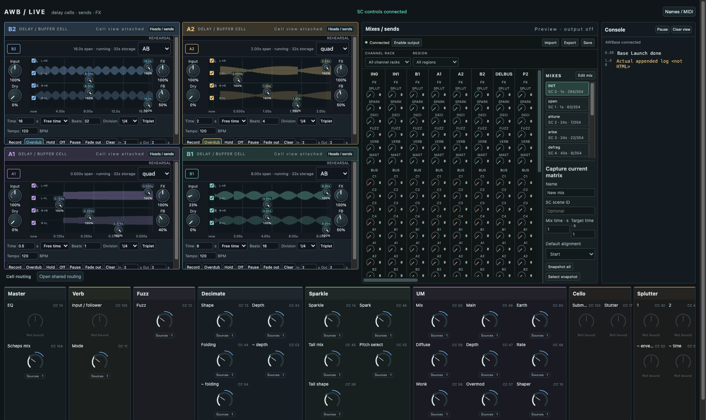

# AWB live surface

First composite GUI on `codex/live-set-surface`, based on AWParam commit `da72790`. Delay renderer attachments come from SuperCollider commit `4feac995`; that dependency is integrated separately on `codex/live-set-sc-integration` because SC and AWB are separate Git repositories. Neither dirty shared checkout is overwritten.

The surface has B2/A2 on top, A1/B1 below, a single rack renderer with mixes, an AWBase console and named FX controls. Four delay tape views borrow **one existing instrument**. Per-cell heads/sends and the one shared routing matrix open on demand. The default unbound launch creates no rack, delay instrument or audio engine.

## SC root and controls

`AWBaseTool : AWBCoreTool` supplies the existing native ToolInstance lifecycle, tracked playback and construction helpers. It adds a bounded console and `t[track].p[name]` dictionaries through `AWTrackControls`. These aliases reference existing AWParams; they allocate no duplicate controls or modulation buses. MIDI input is explicitly attached with the preserved channel/CC/range/pickup metadata. Opening the surface initializes no MIDI device and reinstates no Bitwig remote-output banks.

`bindFirstPass(set, own:true)` adopts an already-ready AWBFirstPassSet and aliases its Verb, Deci, Sparkle, Fuzz and shared UM controls. The set must have `verbProfiles`, `fxProfiles`, `fuzzPlugin` and `sharedFX` enabled. Unsupported legacy controls remain visible and unbound: EQ, Verb's upstream input/blender, Submarine/Stutter and Splutter. No approximation is silently substituted.

Add these class directories to your selected WIP library, with the existing Tool framework:

- `apps/core/sc/classes`
- `apps/param/sc/classes`
- `apps/live-set/sc/classes`
- The existing Rack/Chain and `apps/rack/sc/sets/awb52` dependencies listed by the set README.

Do not include the test classes or archived benchmark copies. No class-path or plugin installation is performed by this branch.

```supercollider
~liveInstance = AWBaseTool.open((name:"Live", params:[]), (server:s));
~liveBase = ~liveInstance.tool;
~liveBase.whenReady({|base|
    base.bindFirstPass(~awb52, own:true);
    base.log("Live set ready");
    ~liveView = base.gui((
        shellRoot:"/private/tmp/awb-live-set-surface",
        delayURL:"http://127.0.0.1:50244/" // existing instrument; use its actual URL
    ));
});
~liveBase.t[\deci].p[\deciShaper].set(0.5, 1);
// Explicit only, after selecting/initializing a MIDI input:
// ~liveBase.t[\deci].attachMidi(\deciShaper, ~fcb);
// ~liveView.close;       // borrowed GUI and observation only
// ~liveInstance.close;   // owned first-pass set and native root resources
```

The delay URL does **not** adopt or stop the external instrument. Prepared-host `UBPGraphController` adoption and its separate wet/input connections to the rack remain unfinished. Its graph currently has a prescribed acyclic internal order. The composite does not route all cells through one common rack channel, instantiate four private engines, or recreate cell routing in the rack. That adapter must be settled and verified before claiming a fully integrated live set.

`AWBaseTool.log(message, level)` feeds a bounded 500-entry console with delta updates. It does not intercept old `AWBase` objects automatically. Clear view and Pause affect only this viewer.

## Drawing and bridge

Local knob edits paint on the next display frame. Measured base/amount/effective values use the shell's shared sparse observation broker at 8/15 Hz. Metadata and configuration travel only on connection/recovery or change. Semantic IDs disambiguate similarly named parameters. The composite identifies AWBaseTool in NodeManager while its borrowed parameter inspector keeps its own token and lifecycle. Modulation details expose numeric base, amount, overall curve and source controls in a popup that avoids the FX strip's clipping.

Delay views retain their existing instrument protocol and SharedWorker feed. Their controls have not yet been converted to the new AWParam inspector protocol. Compact embedding changes layout only. Both original source documents are preserved; source hashes are in `fixtures/` and `tool-artifacts/buffer-views/0.1.0/SOURCE.json`.

## Verification

Builds: `npm run build --workspace @awb/live-set`, `@awb/param`, `@awb/rack` under Node 22.

- 15 private SC contracts: native root, namespaced borrowing, launch bindings, bounded logs and ownership.
- 7 real-sclang UDP assertions: console snapshot/delta, MIDI metadata, actual namespaced AWParam edit and owner closure. DSP commands are captured; no engine booted.
- 23 composite Electron assertions with synthetic parameter observations and a single explicit delay rehearsal backend: four requested views, one delay observation stream, independent cell edits, on-demand shared routing/heads, narrow AWParam edits, popup bounds and borrowing teardown.
- 16 unchanged standalone AWParam Electron assertions.
- Focused Node catalog/runtime, parameter model/broker and shell manifest/runtime checks. Exact final counts and logs are recorded in `verification.json`.

No audible audition, physical-input/routing verification, dropout test or GUI cost measurement is claimed. Live testing follows the prepared-host adapter, including shared scopes and rack transport.

Rehearsal visual check (synthetic observations, no audio):


