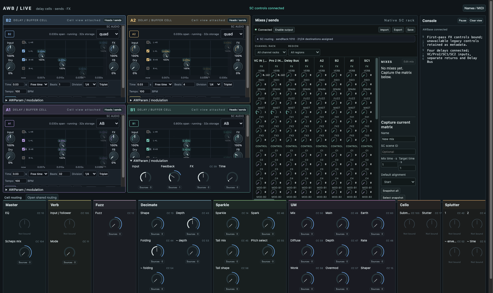

# AWB live surface

The live surface now connects the first-pass SC FX set, one four-cell delay graph, the native send rack, AWParams and the AWBase console on one existing SC server. The composite places B2/A2 on top and A1/B1 below. Heads/sends open per cell; the cell routing panel opens once for the shared graph.

Start with [with-delays.scd](sc/examples/with-delays.scd). It configures a stopped server explicitly, starts the prepared set, then attaches delays and opens `AWBaseTool.gui`. It never reboots an existing graph. Physical input indices remain explicit: confirm the MOTU indices before enabling `connectInputs`.

## Class and native setup

Use Node 22 and run from the AWB root:

```sh
npm run prepare:delay --workspace @awb/live-set
npm run build --workspace @awb/live-set
npm run build --workspace @awb/rack
```

The preparation script generates 44.1/48 kHz plans and builds the per-host `UnifiedTape.scx` and waveform addon in `apps/live-set/.build`. It starts no engine and installs nothing globally. It uses `/Users/willy/supercollider` for SC headers by default; `SC_SOURCE` can select another source checkout. The example includes this plugin directory in this server's plugin path **before boot**. Choose the plan matching the actual server rate.

Select these class directories alongside the existing Tool framework, then recompile sclang:

- `apps/core/sc/classes`, `apps/param/sc/classes`
- `apps/rack/sc/classes`, `apps/chain/sc/classes`
- `apps/rack/sc/sets/awb52`
- `apps/live-set/sc/classes`
- `apps/live-set/sc/dependencies/unified-buffer`

Do not include tests, archived classes or the original prototype's duplicate dependency snapshots. The first-pass set also requires its existing EnvDetect3/VSTPlugin dependencies and restored FX plugins. No global class-path changes are made by this branch. Frozen delay dependencies and their original commit/hashes are recorded in `DEPENDENCIES.json`; renderer provenance is in `tool-artifacts/buffer-views/0.1.0/SOURCE.json`.

## Routing and ownership

`AWBDelayRack.configure(spec)` adds Delay Bus, B1, A2, B2, A1, SC1 and SC2 to the two original inputs: nine persistent rack channels, each exposing the existing eight FX and sixteen control destinations. VC and Pro2 can independently enter every delay cell. SC1 and SC2 feed A1. Cell routing follows the acyclic **B1 → A2 → B2 → A1** order and remains inside the delay graph.

Delay inputs read the rack's post-fader/mute/solo outputs with an explicit one-block `InFeedback` boundary. Every cell has an independent stereo buffer and wet return channel. Delay Bus aggregates the selected wet returns, initially routes to clean Mast and has one shared AWParam fader. Individual cell sends begin at zero to prevent summing a second copy. The four 32-second stereo buffers use approximately 45 MiB at 44.1 kHz, separate from SC's real-time memory pool.

Delay input route gains and cell input gains begin at zero. Select both to begin recording; the startup example shows this. The aggregate output remains available while cell tails continue. Master/dry routing should be reviewed before an audible audition.

`base.bindFirstPass(set, own:true)` and `base.bindDelays(plan, configuration, action)` give AWBaseTool explicit ownership. Closing a GUI releases its observers/readers only. Closing the base retires the delay graph, AWParams, buffers and adopted FX set. Persistent owned objects use container lifetimes so NodeManager does not discard them based on `Object.isPlaying`.

## Controls and console

`t[track].p[name]` is a convenience dictionary referring to the actual AWParams. Delay aliases include `inOf`, `fbOf`, `fxOf`, `sliOf` and named source routes. Delay Bus's `fader`, the rack level control and native delay Master control change the same AWParam baseline. Existing mappings stay connected when these values change. Each cell has an expandable AWParam drawer exposing base, amount, effective value and registered sources.

The preserved pedal channel/CC metadata is available through the semantic controls. MIDI input must be explicitly selected and attached, for example `base.t[\b1].attachMidi(\fxOf, ~fcb)`. Opening the GUI initializes no MIDI device and restores no Bitwig remote-output banks. Legacy delay blender/envelope/tap aliases and unsupported FX controls remain visibly unbound until their replacement behaviour is implemented. Per-head controls still use the native graph's named literal controls.

`base.log(message, level)` sends bounded history plus deltas to the console. The view's Pause and Clear affect this viewer only; old AWBase logging is not automatically intercepted.

Local AWParam edits paint on the next display frame. Observed control values use the sparse shell control bridge. Delay configuration travels on connection/recovery and as changed fields, with a heartbeat rather than configuration polling. The four stereo waveforms share one network backend and existing 20 Hz observation feed. Owner loss disables the borrowed connection and detaches all eight native readers.

## Verification and next gate

The actual first-pass FX set, delay graph, rack and Electron surface were verified together: **26 SC/audio assertions, 11 bridge assertions, 8 real GUI assertions, 23 focused Node tests and 15 SC contracts passed**. This includes independent input routing, mute behaviour, one aggregate sum, preserved modulation through GUI edits, rhythmic metadata on reopen and clean ownership teardown.

Hardware output was muted and signals were captured inside SC. Physical-input audition, extended dropouts and CPU/headroom with GUI and scope bridge remain the next test gate. This is functional readiness, not a performance result. See [shared-host verification](docs/shared-host-audio.md) and `verification.json` for settings, evidence and remaining work.


