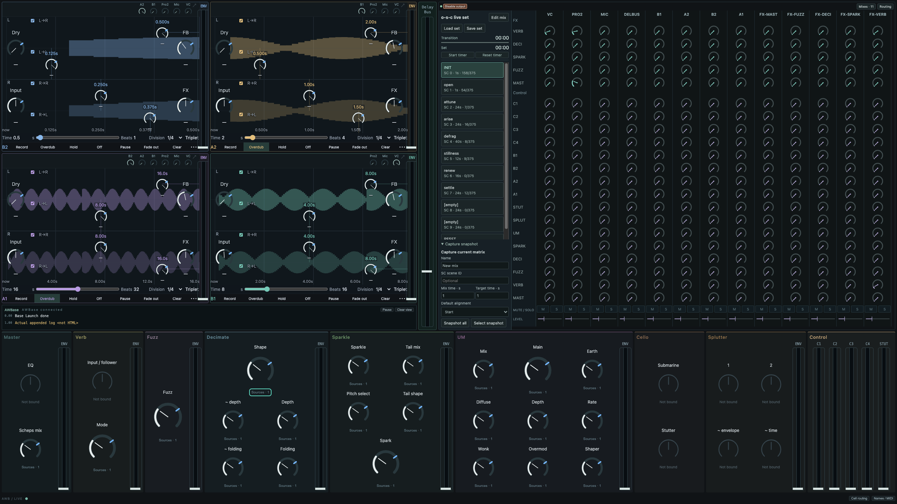
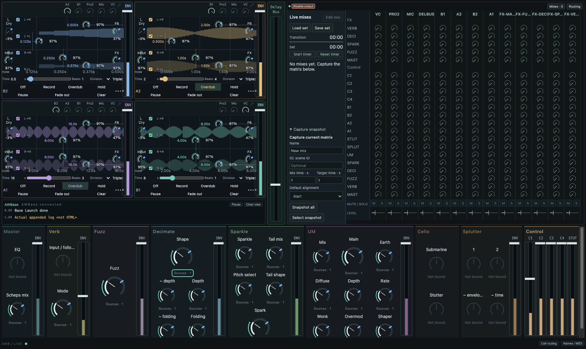
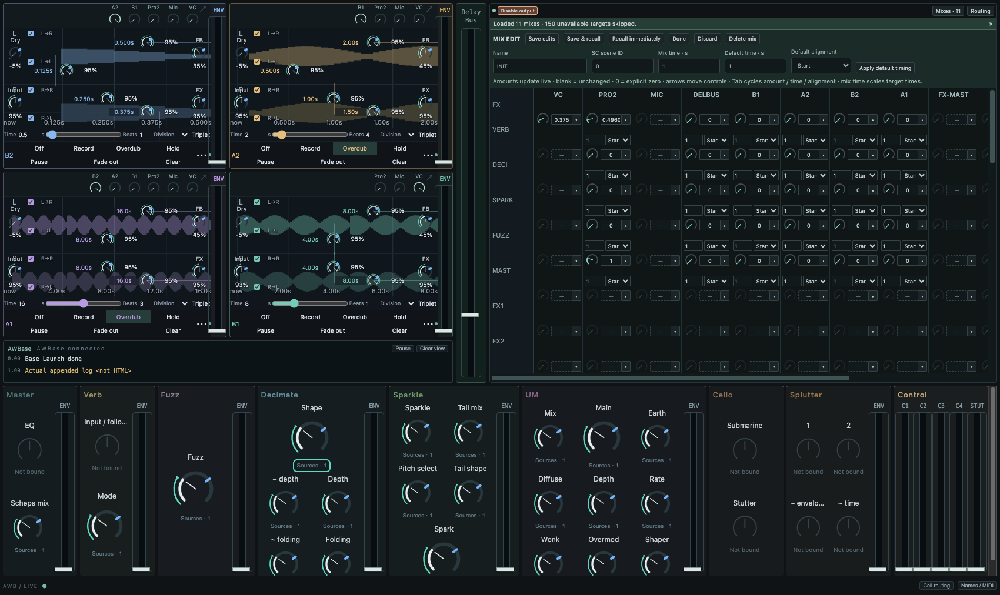

# Live surface GUI verification — 8 October 2026

The rack and live-set production bundles were rebuilt with Node 22. The focused Node suite passed **55 tests**, with two SC-dependent tests skipped in that standalone invocation and exercised separately by the complete rack regression. The isolated Electron integration fixture passed **62 checks**, the private SC language contracts passed **15 checks**, and captured input/FX-return messages passed **24 checks**. The new offline feedback render passed **6 checks**, including exactly one block of latency; the legacy rack/control-send renders passed **88 + 17 audio assertions** and their actual sclang UDP bridge regression passed. No real-time server or hardware device was started. These establish GUI, protocol and ownership behaviour; detector audio and GUI performance under DSP load were not rerun.

The normal thirteen-source matrix displays five active FX sends and sixteen control sends. The three reserved dynamic FX destinations remain allocated and editable in mix mode, but their rows and spare FX bank are hidden during performance. The full matrix fits at 1700 × 1040, 1440 × 900 and 1280 × 850. An actual fullscreen window on the connected **2560 × 1440** display passed without page overflow. The SVG matrix grows to fill its available pane; chain knobs also grow with the window. Smaller windows can scroll within the FX bank.

Mix triggers, named collection loading/saving and capture controls stay visible beside the rack. Loading the actual o-s-c library produced eleven named mixes and preserved live values. Legacy 0–127 amounts are translated to decimal gains; legacy control-send levels map to follower amounts. Targets absent from this rack are skipped and reported. Normal rack value readouts are hidden. Mix editing exposes decimal SC values, timing/alignment and 367 controls, including all reserved sends, channel states/levels and follower amounts.

The dedicated Delay Bus fader controls the aggregate delay channel through its existing rack/AWParam binding. Channel levels retain their horizontal strip at the bottom of the matrix. Chain OUT faders are removed. AWBase binding sets FX returns to unity; composite mix recall ignores old FX return targets. Existing gains inside plugin chains remain part of those chains.

Each ENV fader has a rectangular handle and a single coloured bar. The bar samples the existing detector measurement bus, which already includes its amount scaling. It does not apply the amount twice. Registration is sent once on base binding. Observations share the existing native control reader at 15 Hz and transmit only changed values; no new detector synth or OSC read loop is introduced. Hidden views release their meter lease, and owner loss clears observations. Runtime stop releases its lease and ends its stream even if the browser remains open. The fixture uses simulated detector values for these bars.

Recompile the SC class library and reopen the set/surface to load the new AWBase meter registrations. Existing running instances do not acquire the updated class method automatically.

The borrowed delay views retain module-owned parameter controls. Their parent keeps the input routing row and ENV fader. Legacy delay LFO/offset DSP replacement is outside this pass. The console is always visible beneath the delay cells. Delay Bus sits immediately right of the cells, before the set list, which now occupies the left edge of the rack. Scene transitions show a countdown/progress bar; the set timer has manual Start/Pause/Reset. Both clocks are runtime state, recovered on reconnect, with local display updates rather than a telemetry loop. Console, mapping inspector, independent cell edits and ownership teardown passed.

## Input and FX routing additions

The opener defaults to VC 0, Mic 1 and Pro 2 4/5. Mic has an independent stereo rack pipe from its mono hardware source, initial clean Mast route, and routes into all four delay cells. SC1/SC2 are absent. The thirteen source columns comprise eight input/delay channels and five processed FX-return taps (Mast/Fuzz/Deci/Sparkle/Verb).

Return taps can send to every FX, themselves and all sixteen follower audio buses. Extra sends begin at zero. Existing unity main-output routing remains separate; these return-row levels/mute/solo control the additional send branches. The tap is before shared UM/Scheps processing. An offline 44.1 kHz / 256-block render measured baseline 0.1, self-feedback 0.2, cross-send total 0.25 and follower amplitude 0.06; these survived processor replacement and cleared to silence on retirement. Tap latency measured **exactly 256 samples**. See [measured results](fx-return-audio.json) and [verification summary](verification.json).

The full set with real plugins and the new return sends has not been auditioned or load-tested in this pass. Earlier performance/headroom figures do not include the five added send synths. Recompile SC, close an older set and load the opener again; an old server with fewer than six hardware inputs must be stopped first.
