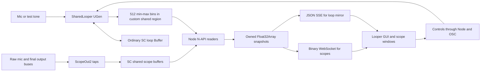

# Shared Loop: implementation and reuse guide

**2026-10-02 hosted update:** Shared Loop scopes now acquire feeds through the shell's shared
SC signal broker. This supersedes the per-instrument three-scope ownership/cadence described
below for ordinary shell launches. Legacy standalone/benchmark paths remain available.
See [current architecture, setup, reuse and validation](../../../apps/awb-shell/docs/shared-signal-engine.md).


2026-10-01 · AWB branch `design/score-studio-layout` · local demo implementation, not a merged reusable bridge package.

The instrument lives in `tool-artifacts/shared-loop/0.1.0`, with hosting changes in `apps/awb-shell`. The original `/Users/willy/dev/sc-shared-looper-demo` checkout is unchanged. The installed shell artifact is the code to edit/rebuild for this integration.

## What was built

A custom C++ UGen records, plays and overdubs an ordinary mono SuperCollider Buffer. It also publishes a compact description of that Buffer for the live loop waveform. Separately, built-in ScopeOut2 UGens capture raw input 1 and final output buses 1–2 for audio scopes, plus a six-channel control-rate LFO/noise bus comparison. The Node backend reads shared memory and serves a sandboxed GUI with controls, live waveform, scopes, visual gain, freeze, horizontal zoom and position panning.

The instrument uses the shell's existing local SC host. It does not select devices, force 48 kHz or boot another server on the hosted path. Frames and timing use the server's actual sample rate. The standalone demo path owns a separate server; use the hosted path for your normal shell workflow.



Three different things matter:

- The **actual loop Buffer** holds audio and is modified by the UGen. Node never maps its backing storage.
- The **loop mirror** contains 512 `[minimum, maximum]` pairs plus position, flags and timing. It is a purpose-built summary in a separate region, updated during recording and overdubbing.
- The **scope buffers** contain short blocks of bus audio. They show input/output now, not the stored loop's accumulated contents. Inward zoom crops one captured block. Outward zoom reduces fixed short chunks and assembles a source-indexed rolling history; missing publications remain gaps.

## File map

All artifact paths below are relative to this guide's folder.

| File | Responsibility | Reuse |
| --- | --- | --- |
| [native/SharedLooper.cpp](native/SharedLooper.cpp) | Actual recording/playback/overdub, dirty-bin rescanning, async region allocation/free | Adapt for your DSP or use this looper as-is |
| [native/shared.hpp](native/shared.hpp) | Versioned three-slot loop-summary layout and atomics | Reuse with matching producer/consumer builds |
| [native/addon.cpp](native/addon.cpp) | Custom loop-region attach/read/detach; JS-owned Float32Array | Reusable for the same summary protocol |
| [sc/SharedLooper.sc](sc/SharedLooper.sc) | sclang UGen declaration and ordered inputs | Needed for direct SynthDef construction with this UGen |
| [sc/build-def.scd](sc/build-def.scd) | Compiles looper and scope SynthDefs without booting audio | Template for your own defs |
| [sc/host.scd](sc/host.scd) | Trusted shell allocation handshake, language allocators, node ordering, teardown | Adapt names/auth/ownership to your host |
| [native/scopes.cpp](native/scopes.cpp) | Legacy standalone mic/stereo/control scope reader; hosted captures use the shell reader | Reusable on the matching SC/Boost layout |
| [server.mjs](server.mjs) | SC/Node attachment, polling, controls, HTTP/SSE and binary scope sockets, ordered stop | Reuse the backend and transport |
| [scope-transport.mjs](scope-transport.mjs) | Binary fan-out, one outstanding frame per viewer, timeout/origin checks | Reuse transport with the same packet protocol |
| [public/scope-protocol.js](public/scope-protocol.js) | Versioned 112-byte selected-channel header and planar Float32 payload codec | Shared Node/browser module |
| [shell-runtime.mjs](shell-runtime.mjs) | Entry point using shell-provided host context | Template for another trusted installed tool |
| [tool-manifest.json](tool-manifest.json) | Tool identity, hosted profile, renderer, runtime, one-view policy | Copy pattern with your own identity |
| [public/app.js](public/app.js) | Stored-loop waveform/playhead and controls | Rendering/control example |
| [public/scope.js](public/scope.js) | Live bus drawing, gain, freeze, X zoom/pan | Adapt into your existing GUI |
| [public/scope-history.js](public/scope-history.js) | Bounded source-indexed chunk ring, gaps and immutable composite views | Reuse for rolling scopes |
| [ASSESSMENT.md](ASSESSMENT.md) | Cost measurements, stability limits, next work | Read before turning this into infrastructure |

Shell-side wiring is in [ToolRuntimeRegistry](../../../apps/awb-shell/src/toolRuntimeRegistry.mjs), [manifestLoader](../../../apps/awb-shell/src/manifestLoader.mjs), [shell main](../../../apps/awb-shell/shell/main.mjs), [nativeScHostSupervisor](../../../apps/awb-shell/src/nativeScHostSupervisor.mjs), [SC bootstrap](../../../apps/awb-shell/sc/AWBHeadlessHost.scd), and [tools.json](../../../apps/awb-shell/tools.json). These are separate from the audio algorithm: they supply host context, launch the backend, enforce sandboxing and stop owned resources.

## Run or rebuild this implementation

From `/Users/willy/awb`, with Node 22 first in PATH:

```sh
export PATH=/Users/willy/.nvm/versions/node/v22.23.2/bin:$PATH
# Prepare shell/workspace dependencies explicitly; start does not build.
npm run build
# In a standalone copy, install its declared dependency with npm ci first.
npm run build --prefix tool-artifacts/shared-loop/0.1.0
npm start --workspace @awb/desktop-shell
```

Start the shell's headless SC host, then **Toolkit Home → Shared Loop → Open looper**. Choose test tone or mic, Record one four-second pass, then Play/Stop or Overdub. Scope buttons open separate mic, output and control-bus windows. Scope gain/zoom/freeze do not change audio. Close and reopen scope windows after editing their HTML/JS/CSS. Backend module changes require restarting the shell because Node caches imported modules; the wider/control update includes rebuilt native code and a changed host allocation, so restart the shell and its owned SC host.

For an attached IDE, evaluate `sc/prepare-host.scd` before booting the local default server normally. It refuses to reconfigure an already-running server. The shell host already loads the bridge; do not paste another startup path into your live setup unnecessarily. Native plugin changes need a deliberate host restart; GUI edits need a renderer reload. SynthDef edits need rebuilding and reloading after closing the old instrument.

The build currently assumes macOS and matching SC 3.12.2 source at `/Users/willy/supercollider`. Set `SC_SOURCE`, `NODE_HEADERS`, and `SC_APP` for other matching installations. SC headers and Boost/TLSF layout matter to the scope reader. `SOURCE.md`, `COPYING-SuperCollider` and `SHA256SUMS.json` record provenance; the hash inventory is not signature enforcement.

## Startup and shutdown contract

1. The shell selects the active host, keeps credentials in trusted code, and invokes `startRuntime`.
2. Node sends `/awb/loop/open` with a fresh positive ID, duration, protocol version and token.
3. Hosted protocol v2 allocates the ordinary Buffer, custom region and looper synth; it reserves demo control buses but creates no scope taps or control generator yet. The legacy path still owns its original scope reader.
4. The reply includes server port, Buffer/node IDs, actual rate/block size and bus identities.
5. Node attaches the loop-summary reader. Scope connections obtain shared signal/display leases from the shell broker; the control generator follows the control-view lifetime. GUI ready is reported after live loop data arrives.
6. On close, stop streams, release signal/display leases, free the looper/control resources and custom region, detach the loop reader and close sockets. Other subscribers retain their shared raw capture.

The shell prevents stopping its host while the runtime is active. Quitting releases runtimes before stopping the shell-owned host. An attached IDE remains user-owned. Normal teardown is tested; forced process termination is not equivalent to this sequence. See the assessment for orphan regions, reader claims and stale mappings.

## How easily this maps to existing code

| Goal | Work involved | Main complication |
| --- | --- | --- |
| Add a scope to an existing SC instrument | Small SC change plus Node attachment/UI wiring | Allocate private scope indices; tap the correct bus/order; manage reader lifetime |
| Reuse this exact looper in another shell view | Moderate wiring | Runtime/manifest registration, matching binaries and ownership integration |
| Put this scope drawing into an existing Node/Electron GUI | Small to moderate GUI work | Reuse data path; convert page-specific DOM IDs into a component if embedding |
| Show accumulated audio in your existing custom looper | DSP/plugin adaptation | Publish changed Buffer regions or summaries coherently, including overwritten/shrinking peaks |
| Observe any arbitrary Buffer without modifying its writer | More work | No generic shared mapping of Buffer storage was implemented; a bounded observer needs read/write/lifetime rules |
| Support multiple instruments, crashes and upgrades | Infrastructure work | Shared tap ownership, epochs/leases, bounded delivery, ABI/version verification |

These are engineering scope estimates, not timed implementation promises.

### Reusing live scopes

You do not need the SharedLooper UGen to scope a signal. The shell path normally reuses its signal broker and `AWBScBusAudio.scd` allocator; see the
[raw/derived lease examples](../../../apps/awb-shell/docs/shared-signal-engine.md).
For a separate integration, add ScopeOut2 to a SynthDef or ordered tap. This sketch matches
the generic reader's 512-frame publications and 1,024-frame storage:

```supercollider
// Sketch: integrate this allocation into your existing owner/lifecycle.
// One extra private counter channel per scope; reader strips it.
micScope = ScopeBuffer.alloc(server, 2);
outScope = ScopeBuffer.alloc(server, 3);

SynthDef(\myScopeTap, { |micIndex, outIndex|
    var clock = Phasor.ar(0, 1, 0, 4194304);
    ScopeOut2.ar([SoundIn.ar(0), clock], micIndex, 1024, 512);
    ScopeOut2.ar(In.ar(0, 2) ++ [clock], outIndex, 1024, 512);
}).add;
// Wait for server.sync before constructing the synth.
// Pass micScope.index/outScope.index; place the tap after the audio writers.
```

In an instrument's own SynthDef, scope the actual signal variable instead of reading a bus. That avoids guessing bus order. For final output, use a defined master group and one host-owned tap. The demo's root-tail repair is a temporary solution, not a general multi-instrument ordering service.

Node's existing API is already C++/N-API:

```js
const scopes = require('./build/scopeview.node');
const handle = scopes.attach(serverPort, micIndex, outputIndex);
const { mic, output } = scopes.read(handle);
// mic.samples and output.samples are JS-owned Float32Arrays.
// Raw channel data: channel * snapshot.frames + frame.
// Minmax channel data: (channel * snapshot.frames + bin) * 2, then low/high.
// Use snapshot.sourceFrames / sourceRate for the time axis.
scopes.detach(handle); // Before the host frees the scope writer.
```

This is an attachment sketch, not a complete disconnect/recovery loop. The current reader expects physical counts 2/3/7 (mono/stereo/six control signals plus a private source counter); make its format checks/API generic if you need arbitrary channel counts. Never attach Qt and Node readers to the same scope index simultaneously: SC's exchange is single-reader. UI subscribers should share the Node reader's copies.

### Reusing the stored-loop waveform

If your writer is a custom C++ UGen, integrate the summary producer alongside its writes. Keep the existing DSP and publish buffer identity/generation, frame count, position and min/max changes. Recompute a dirty bin after overwriting it; only accumulating a historical maximum gives incorrect visuals when feedback reduces peaks.

If your looper is a composition of stock RecordBuf/BufWr/PlayBuf UGens, this demo does not automatically observe it. A companion observer UGen needs reliable write-range/position information, explicit ordering after writers, and bounded scanning. Blindly copying/scanning the whole Buffer in every block is not this design. If the writer cannot supply dirty ranges, amortize scanning and state the resulting visual lag/coherence limits.

Region allocation must remain outside the audio calculation. Do not move shm_open/mmap, general allocation or browser delivery into the UGen's per-block function. Preserve the single-writer/single-reader contract and free the UGen before freeing/reallocating its Buffer.

This compiled-host demo does not register through your ToolInstance/NodeManager/SynthDesc analysis path. Integrate ownership and metadata through the active version of your framework rather than assuming the allocation dictionary is a replacement for it. No live/WIP awbCollider classes were changed for this proof.

## Binary scope delivery and remaining display cost

Scope sample delivery now uses `/scope/socket?kind=mic|output|control`, WebSocket subprotocol `awb.scope.v4`. C++ still returns owned Float32Arrays. Node retains those arrays, copies their bytes into a versioned packet, and fans out one immutable packet per active kind. The browser uses `binaryType = 'arraybuffer'` and creates a Float32Array view over its payload; no scope sample Array.from/stringify/parse occurs.

The 104-byte header includes version, kind, display/source frame counts, format, channels, sequence, source/audio rates, block size, peak/RMS, instrument generation and exclusive sourceEnd. Frames/sourceFrames describe each short chunk; the browser ring composes the displayed window. Data is planar and little-endian. See [BINARY_TRANSPORT.md](BINARY_TRANSPORT.md) for the original binary measurements, and [WIDE_SCOPES.md](WIDE_SCOPES.md) for the current extended layout and capture modes.

Each browser acknowledges a decoded frame with a small JSON `{ack: sequence}`. The server keeps at most one application frame outstanding per viewer and one latest snapshot per kind, skips intermediate updates while waiting, and terminates an unresponsive viewer after five seconds. The browser reconnects with bounded exponential delay. Freeze holds the displayed snapshot but still receives/acknowledges frames, preserving previous behavior. Controls and changed connection status remain JSON; the stored-loop min/max waveform remains JSON SSE.

`/api/scopes` returns metadata and transport counters only. The previous sample SSE endpoint is removed. Trusted measurement code can use the bridge's owned `scopeSnapshots()` or consume/decode binary frames. No Qt reader may attach to the same indices concurrently. Instrument generation is an instrument-lifetime identity check; it is not a producer heartbeat or automatic SC-reboot recovery.

The artifact declares `ws` and includes a lockfile. In AWB it uses the already-installed dependency; a standalone extracted copy needs `npm ci`. No bespoke WebSocket framing is implemented. Packet/header validation, byte fidelity, wrong origin/protocol rejection, blocked-reader latest-frame delivery and timeout are tested.

A raw pair at 1,024 frames/chunk occupies 12,496 bytes including both headers, versus about 67 KB as JSON. Browser/GPU upload boundaries still copy as required; this is not end-to-end zero-copy. Binary delivery changes transport/allocation cost. Outward zoom changes native chunk reduction and browser history span while capture length/cadence stay fixed; Canvas still paints at display cadence.

The scope collector now polls every 8 ms independently of the 33 ms loop-summary poll. SC publishes 1,024-sample audio chunks or 32-value control chunks. At ¼×/¹⁄₁₆×, C++ reduces each chunk using min/max step 4/16. The browser rings these chunks over 4/16 baseline windows. Missing source intervals remain gaps; it never joins sparse snapshots into a falsely continuous time axis. Inward zoom crops a composite view. Freeze preserves a view copy while the ring continues updating. See [WIDE_SCOPES.md](WIDE_SCOPES.md) for source provenance, counter limitations, protocol and current budgets.

Qt ScopeView bypasses Node/browser transport. [COMPONENT_COSTS.md](COMPONENT_COSTS.md) retains the historical matched comparison without clock channels. Current scope allocations add counters and cannot be compared fairly by attaching an unmodified Qt ScopeView; the benchmark no longer runs those phases. Earlier CPU results are not rolling-mode measurements.

## Validation and portability

```sh
# Lightweight OSC protocol checks:
npm test --prefix tool-artifacts/shared-loop/0.1.0
# Real shell/SC lifecycle and controls, not just a build:
npm run test:shared-loop --workspace @awb/desktop-shell
# Minimal component benchmark, without Studio or Field:
node tool-artifacts/shared-loop/0.1.0/tests/run-component-bench.mjs
# Scope-only binary measurement:
node tool-artifacts/shared-loop/0.1.0/tests/run-component-bench.mjs --rolling-only
```

The minimal benchmark owns an isolated SC process and transient Electron scope windows. It uses quiet output probes, reports CPU/RSS and cleans up its own server/region. It does not touch your existing host. It is optional measurement tooling, not a sustained-load test or production runtime.

Reuse the existing gates when adapting: test waveform agreement against actual Buffer data, feedback reducing peaks, clear, non-default rate, reader detach/reattach, normal close preserving other nodes, and quit while active. Add your actual channel/layout/ownership cases. For production, add long loaded soaks, a deliberately stalled consumer and crash/reboot/device-change tests. Porting beyond this macOS/scsynth/SC-version build requires native verification, not just an npm install.

For rolling history controls, true control bus, current protocol and focused test policy, see [WIDE_SCOPES.md](WIDE_SCOPES.md).

The control display now contains 1 Hz / 10 Hz LFOs and four independent LFNoise0 channels at
nominal 1 / 5 / 20 / 100 Hz, with stacked lanes and an all/noise/slow/fast selector. The current
v5 header carries physical channel IDs and selected peak/RMS planes. See the
[shared-engine guide](../../../apps/awb-shell/docs/shared-signal-engine.md) for the current layout.
WIDE_SCOPES.md retains the earlier v4 measurements.

For measured active-bridge/idle-connection overhead and the increment from one to four/six
visible control lanes, see [CONTROL_COSTS.md](CONTROL_COSTS.md). The dedicated benchmark mode
uses the same six-channel feed and no audio viewers; it changes test-only painting/selection.

[Multichannel audio measurements](AUDIO_CHANNEL_COSTS.md) compare 1/2/4/6 drawn audio lanes
from a fixed six-channel SC feed, in raw and wide modes. The isolated fixture leaves the
normal stereo instrument and live host unchanged; it is measurement tooling, not a deployed
arbitrary-channel scope API.


[Canvas/window comparison](LAYOUT_COSTS.md) measures 1/2/4/6 control and audio lanes in raw/wide
views on one canvas, separate canvases in one window and separate windows. The 71-phase
isolated fixture includes GPU-process/helper CPU and retains equal total waveform area.
Separate canvases share feed/history; separate windows duplicate full-feed processing.
Production scope files and the live host are unchanged.


[Current native Qt comparison](QT_COSTS.md) pairs stock ScopeView and the binary rolling browser
path at approximately 30 Hz, fixed waveform area, short/wide control/audio spans and
one/six lanes. The 58-phase run includes Electron GPU/helper CPU, repeat ranges, memory,
freshness differences and retained screenshots. Wide native captures are not equivalent
to continuously updated browser history. Production runtime and the live host are unchanged.


The current [scope optimisation report](../../../apps/awb-shell/docs/scope-optimisation-costs.md)
measures the shell broker before/after shared display derivation and selected-channel delivery.
It includes isolated capture, one/six lanes, canvas/window layouts, duplicate adapters, freeze,
and looper-only/playback/GUI-with-raw-peer cases. Earlier reports remain historical evidence.


Scope **Refresh → Auto / 30 fps / 15 fps** is independent of capture/reduction. Every available
packet still enters history and is acknowledged; only building/painting the display waits.
Auto is the default, controls redraw promptly and freeze stops painting while receiving.
The [cadence report](../../../apps/awb-shell/docs/scope-cadence-costs.md) includes CPU, paint vs
ingress rates, pauses, source gaps and freshness tradeoffs. Reuse `public/scope-painter.js`
with data/history/acknowledgements outside it; close it when its view closes.


The [current scope-slider guide](../../../apps/awb-shell/docs/scope-zoom-sliders.md) covers
logarithmic X/Y controls, fractional source-bin alignment, bounded capture-profile changes and
frozen zoom/pan. This UI-only update requires reopening scope windows, keeping the looper's
buffer and SC host running. Y changes visual amplitude only; X retains the existing supported
audio reduction profiles and ordered raw control history.


**Trace connections:** every individual-sample trace defaults to Connected; select Stepped
for sample-and-hold geometry. The choice applies uniformly to audio and control sources and
can change while frozen. It does not infer signal character, alter samples, request a new
capture, or change meter/painting rates. Missing samples split paths in either mode. Reduced
audio retains its min/max envelope; the selector is disabled in that view, remembering the
raw connection setting. Reopen only scope windows to load this update.
[Mode screenshots and verification](../../../apps/awb-shell/docs/scope-display-polish.md#trace-connection-modes--2026-10-03).


The [drawing/capture follow-up](../../../apps/awb-shell/docs/scope-next-costs.md) measures
Connected/Stepped and four drawing/history stages, then isolates capture jitter and a Node
worker experiment. Conservative held-run geometry and cached labels/dividers are shipped;
history and reader experiments remain test-only. No audio-route/native change. Reopen only
scopes, keeping the instrument and host running. Full results and reproduction are linked.


The shell now also has an independent **Scope** tool for arbitrary audio/control bus ranges
(1–16 adjacent channels), sharing the same capture engine and tested display helpers. A running
looper is not required. [Standalone usage and reuse guide](../../../apps/awb-shell/docs/scope-tool.md).
